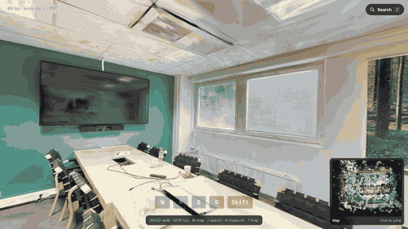
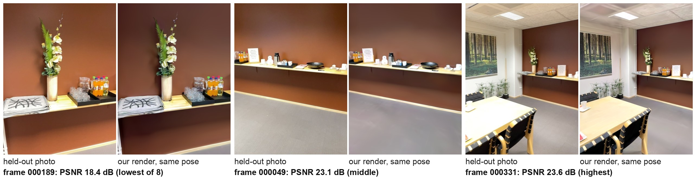
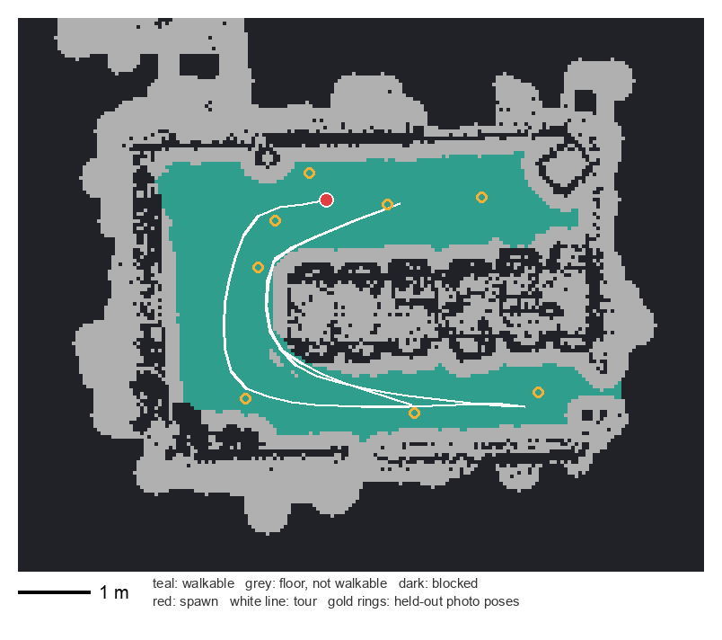

# Namma Space

**One phone video. One command. A room you can walk through.**

Namma Space turns an ordinary indoor phone video into a level 3D Gaussian-splat scene, with an estimated real-world scale, that you walk through in a web browser. It needs no LiDAR and no hand editing. Every tool in the path is open and allows commercial use (`LICENSES.md`).



*A held-out photo (never used in training) beside our render at the same pose, three examples, and the plan the viewer walks on:*




## Results

<!-- results:start -->
Measured on `fix-honka` (a public room; the final entry uses our own room, `room`). Sources: `runs/fix-honka/report.json`, `timings.json`, `90_verify/verify.json`, `eval/results/*.json`.

| What | Value |
|---|---|
| Scene | MuSHRoom honka (public test room) |
| Held-out photos, PSNR / SSIM / LPIPS | 21.51 dB / 0.822 / 0.220 (8 photos never used in training) |
| Scene size | 611,196 splats, 13.3 MB (plus a 3.4 MB preview) |
| Walk in the browser | 60.0 fps, p95 16.7 ms, on screen after 0.32 s (one Apple M1, headless Chrome; other hardware unverified) |
| Run time | 60 min in all stages, 60 min of it in GPU stages (shared RTX A6000) |
| Scale | ±13 % (68 % interval); estimated, not checked by tape |
| Walls | 200 random walks and 16 pushes: 0 positions in blocked cells |
| Scale check, two public rooms | 4.3 % (honka), 3.1 % (vr_room) automatic error; true scale inside the 68 % interval in both |
| Geometry vs Faro laser scan, F@5cm | honka 0.52 phone only vs 0.80 iPhone LiDAR fusion; vr_room 0.40 vs 0.74 (same fusion and crop; our camera path was fitted to the dataset path first, scale included) |
| Trainer check, Mip-NeRF 360 room | 32.48 dB (published 31.36 dB) |
<!-- results:end -->

Phone-only geometry scored below iPhone LiDAR fusion on both public rooms. Details and caveats: `eval/README.md`.

## Run it

```bash
./ns doctor                              # checks the Mac tools and the GPU host
./ns run path/to/video.mp4 --name room   # capture check, then every stage, then the viewer folder
python3 viewer/tools/serve.py runs/room/80_web   # open http://127.0.0.1:5178/?scene=room
```

Setup (Mac tools, a GPU host with Docker, the images, headless Chrome through Playwright or `NS_CHROME`) is in `test/README.md`, section "What you need". About 1.5 hours per room on a shared RTX A6000; the measured stage times are in `runs/<run>/timings.json`.

## Smoke test

A 10 to 25 minute run on 60 public photos (sample data is in `test/data/honka60/`):

```bash
./ns run --frames test/data/honka60/frames --name smoke --quick \
    --kind public --license "CC BY 4.0" --attribution "MuSHRoom dataset (Ren et al. 2024), room honka"
```

Unit and end-to-end tests (no GPU needed for most): `./ns test all`.

## Viewer

Hosted link: not published yet. It goes here after we approve publishing: `[HOSTED LINK]`.
Offline copy: the `80_web/` folder of a run (for the public dry-run room: `runs/rh-honka/80_web/`). Run `python3 -m http.server 8000` in it and open `http://localhost:8000/?scene=rh-honka`.
Keys: WASD walk, M map, C photo-versus-render check, T tour benchmark, K measure, ? help.

## Documents

- `docs/SOP.md` and `docs/SOP_card.pdf`: capture steps and checks.
- `docs/build/01_Technical_Abstract*.pdf` and `00_START_HERE*.pdf`: built by `docs/tools/build_docs.sh <run>`.
- `video/`: demo video script and build (`video/build_video.sh <run>`).
- `eval/README.md`: public-room checks and their caveats. `docs/claims.md`: what we may claim, and the evidence.
- `LICENSES.md`: licences and credits.

## Licence

Repository code is Apache-2.0. Product and model licences are listed in `LICENSES.md`; unverified items stay marked as unverified.
